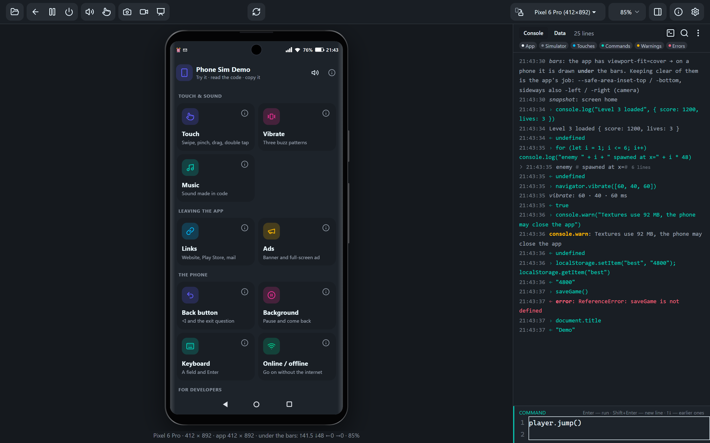
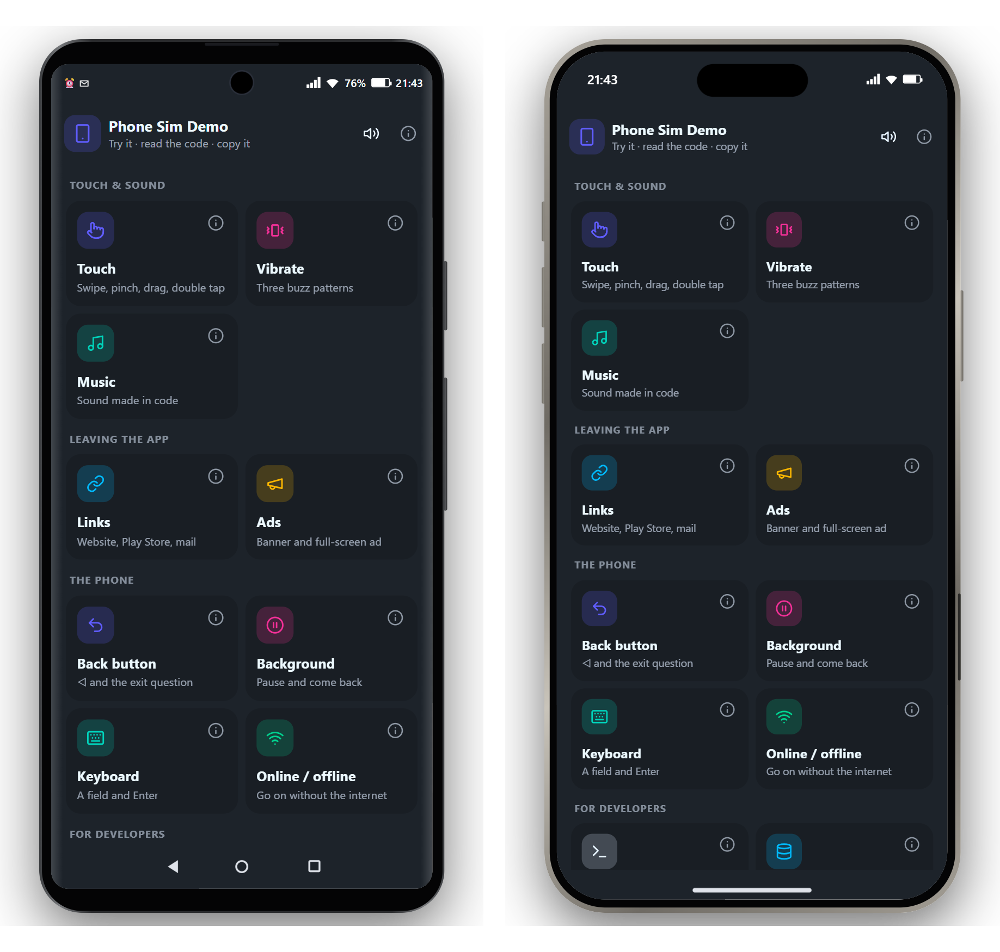
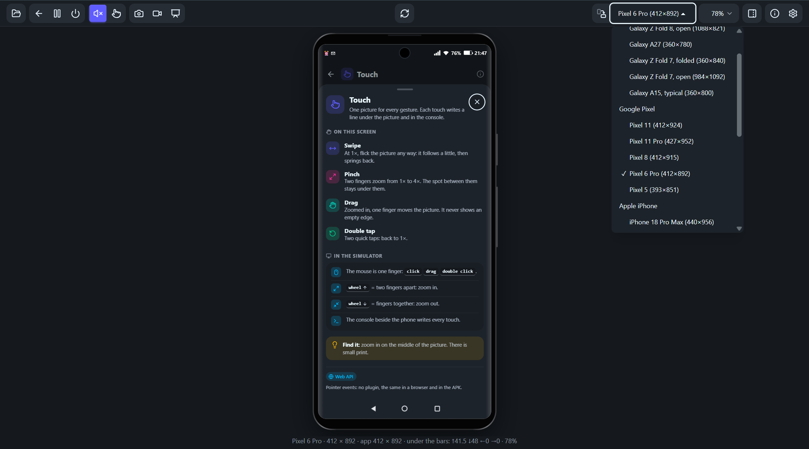

# Phone simulator

Test an HTML mobile app (Capacitor, any Android WebView app) in a desktop browser, inside a phone frame that behaves like a phone.
Plain HTML and JavaScript: no build step, no server, works offline straight from `file://`.

**Live demo:** https://kandelucky.github.io/phone-sim/



## What it simulates



- **Screen sizes**: a list of phones, foldables (folded / open) and tablets in the top bar, each real one in its own frame (body, keys, camera hole / notch / Dynamic Island), or your own width × height (⚙ → Size). Portrait and landscape.
  An iPhone or the iPad in the list turns on **iPhone mode**: the iOS status bar, the home indicator, the notch or the Dynamic Island,
  the iOS safe areas, and no system Back (a swipe from the edge stays with the app; up from the home indicator = Home).
- **System bars**: status bar, navigation bar (3 buttons by default, gestures or hidden) and the camera hole. With `viewport-fit=cover`
  the app is drawn under them and gets the same `--safe-area-inset-*` CSS variables Capacitor 8 sets on a phone.
- **Buttons**: Back (◁) is sent to the app; Home (○) sends it to the background.
  In gesture mode the swipes work too: in from the left or right edge = Back, up from the bottom = Home.
- **Background and kill**: pause / resume through `visibilitychange` (`document.hidden` turns true, `requestAnimationFrame` stops).
  Kill gives the app no warning, as on Android; the next start is a cold start.
- **Touch**: the mouse over the screen acts as a finger. The app gets pointer and touch events with `pointerType: "touch"`,
  and a tap gets the mouse events and `click` that Chrome sends on a phone. The mouse wheel is a two-finger pinch.
  Each gesture (tap, swipe, scroll, pinch) can be written to the console as one line, with the element it landed on.
- **Volume keys**: 0 to 15 steps plus mute. They scale all the app's sound, `<audio>`, `<video>` and Web Audio.
- **Vibration**: `navigator.vibrate` (also what Capacitor's Haptics plugin calls in a browser) lights a zigzag on each side of the phone
  for every buzz of the pattern. As in Chrome on a phone, it is refused before the first touch on the page.
- **Links**: as in Capacitor, a link to another address (also `target="_blank"`, `location.href`, `window.open`) does not open inside the app.
  The app goes to the background and the screen shows the app that would open (browser, Play Store, mail, phone, messages, maps)
  with the address; Back returns to the app. A web address can be opened on the PC with one click.
- **Ads**: a stand-in for the AdMob plugin (`@capacitor-community/admob`): a banner over the app and a full-screen ad, with the plugin's
  calls and events. ⚙ → Ads → No ads makes every ad fail ("No fill"), to check the app works without them.
- **Console**: the app's own log lines with the time (`log()` and `console.log` / `warn` / `error`), uncaught errors and
  Promise rejections in red, and what the simulator did. Filter chips (app / simulator / touches / commands / warnings / errors, any number at once), search, copy, save as .txt.
  The panel sits right of the phone or under it, or is hidden; drag its edge to resize.
  The same line in a row is written once with a count (×12); 3+ similar lines in a row (only the numbers differ) fold into a group you click open. A command line under the console (a small editor, Shift+Enter = new line;
  show / hide from the console head) runs JS inside the app (for an app opened from a file, from localhost, or from the simulator's own address)
  and shows the result. Touches and commands have their own colour.
- **Data**: a tab beside the console with the app's `localStorage`: view, edit, delete, and Clear data to test a first launch.
- **No internet, font size, FPS**: ⚙ → Internet off fails the app's requests to other addresses and sets `navigator.onLine`;
  Font size 130 % / 200 % shows what Android's system font size does to the layout; the FPS meter shows where an animation stutters.
- **Keyboard**: a text field in focus brings up a keyboard and makes the app shorter, as on a phone; its keys type into the field, and so does the PC keyboard.
- **Screenshot**: the camera icon saves a PNG of the phone's screen (and says whether its size fits Google Play's listing rule),
  the phone with its frame on a transparent background, or the whole window; twice as sharp as the screen shows it.
- **Video**: records the phone's screen, or the phone with its frame on a plain background, as MP4 or WEBM, with the tab's sound; twice as sharp as the screen shows it.
- **Presentation mode**: hides everything but the phone, for a demo video or for showing the app to someone. Its buttons (video, screenshot, exit) wait behind a faint dot in the top-left corner.
- **Themes**: 35 daisyUI themes, sent to the app as `data-theme`.
- English and Georgian interface, and a built-in guide (ⓘ).

## Quick start

1. Download or clone the repository.
2. Open `index.html` in Chrome or Edge: the phone opens with the demo app.
   `sim.html` opened directly starts with an empty phone: press **Open app** (the folder icon) to put an app in it.

## Use it with your app

**The quickest way:** on the live demo (or the simulator served by any local server), press **Open app**
(the folder icon, far left of the top bar) → **Choose folder…**, and pick your app's folder (the one with `index.html`, or with `www/` or `dist/` inside). The app opens in the phone
with everything working: `sim-bridge.js` is added by itself, and ↻ shows your edits. The files stay on your computer:
a service worker (`sim-sw.js`) hands them from the folder to the phone. Chrome and Edge only; a page refresh forgets the folder.
Have an APK instead? **Choose APK…** in the same panel opens the web part of an Android app (`assets/public/` from Capacitor,
`assets/www/` from Cordova or Construct 2), unpacked in the browser. A native app (Java / Kotlin, Unity, Flutter) cannot run here; the console says so.
No app at hand? The same panel has **Download the demo app** (`demo-app.zip`): unzip it and choose its folder.

**From a file, or to keep it:**

1. Copy `sim-bridge.js` into your app's folder and add one line to the app's `<head>`, before any script that makes sound:
   ```html
   <script src="sim-bridge.js"></script>
   ```
2. Open `sim.html`, then **Open app** (the folder icon). In the panel's field, type or paste where your app is and press Enter:
   - a path from `sim.html`: `myapp/index.html`
   - a file path from Windows: Shift + right-click the file → Copy as path, then paste (the quotes are fine)
   - an address, for example a local dev server: `http://localhost:5173`

   It goes into the address bar as `?app=…`, so a refresh opens it again. An empty field empties the phone again.
   File paths do not work on the live demo (a web page cannot open files from your computer): download the simulator for them.
3. To open your app every time, set it at the top of the script in `sim.html`:
   ```js
   var APP = "myapp/index.html";
   var KEY = "myapp";   // localStorage prefix for the simulator's settings, one per project
   var DEFAULT_THEME = "dark";   // the theme on first start (optional)
   ```

`app.html` is an empty starter that is already wired up. Outside the simulator (opened on its own, or built into an APK)
the bridge does nothing, so the same files run on a phone unchanged.

## Install it as an app (Phone Sim)

On the live demo (or the simulator served by a local server), Chrome and Edge can install it as its own app, **Phone Sim**:
the install icon at the right of the address bar, or Chrome's ⋮ menu. It opens in its own window, gets an icon in the Start menu,
and works offline after it was opened online once.

**Open your app from VS Code (or any program).** The installed app opens links like `web+phonesim:http://localhost:5500/`:
whatever opens such a link shows that app in the simulator window. An open window is reused, and the same address again loads it afresh.
The first time, the browser may ask whether to open Phone Sim. Run your app on a local server (for example VS Code's Live Server, port 5500),
make sure it includes `sim-bridge.js`, and add this task to the project's `.vscode/tasks.json`:

```json
{
  "version": "2.0.0",
  "tasks": [
    {
      "label": "Open in Phone Sim",
      "type": "shell",
      "command": "Start-Process 'web+phonesim:http://localhost:5500/'",
      "options": { "shell": { "executable": "powershell.exe", "args": ["-NoProfile", "-Command"] } },
      "osx": { "command": "open 'web+phonesim:http://localhost:5500/'", "options": { "shell": { "executable": "/bin/sh", "args": ["-c"] } } },
      "linux": { "command": "xdg-open 'web+phonesim:http://localhost:5500/'", "options": { "shell": { "executable": "/bin/sh", "args": ["-c"] } } },
      "problemMatcher": []
    }
  ]
}
```

Then Ctrl+Shift+P → **Tasks: Run Task** → **Open in Phone Sim**. Change the port to your dev server's.

**The first time, Chrome asks for permission.** A page from the web that wants to open something on your computer (`localhost`,
`127.0.0.1`, `192.168.…`) needs your permission: Chrome asks once, under the address bar, for access to other apps and services on this
device. Until you allow it the phone stays white; after 4 s the console reminds you. The simulator on a local server is not asked.

## The bridge API

| Function | What it does |
|---|---|
| `log("text")` | one line in the console, with the time; HTML is allowed, except for an app opened from another address (see Tips) |
| `simScreen("name")` | the console line "snapshot: screen name"; call it when the visible screen changes |
| `onBack(fn)` | `fn` runs on Back. What back means (close a dialog, previous screen, ask to exit) is the app's decision |
| `onPause(fn)` | `fn` runs when the app goes to the background. Save progress here: a killed app gets no warning |
| `onResume(fn)` | `fn` runs when the app comes back |
| `simExit()` | the app's own exit button: in the simulator the app closes, on a phone call Capacitor `App.exitApp()` instead |

```js
onBack(function () { if (dialog.open) dialog.close(); else showPreviousScreen(); });
onPause(function () { localStorage.setItem("progress", JSON.stringify(state)); });
onResume(function () { /* restart timers, music */ });
```

`onPause` and `onResume` hang on `visibilitychange`, so outside the simulator they run on the real event.

## Ads (AdMob)

Inside the simulator the bridge gives `window.simAdMob`: the calls and events of the AdMob plugin for Capacitor
(`@capacitor-community/admob` 8), answered by the simulator with stand-in ads. Pick it with one line, and the same code runs on a phone:

```js
var AdMob = window.Capacitor && Capacitor.isNativePlatform() ? Capacitor.Plugins.AdMob : window.simAdMob;

AdMob.addListener("bannerAdSizeChanged", function (s) { room.style.height = s.height + "px"; });   // the banner lies over the app
AdMob.showBanner({ adId: "ca-app-pub-3940256099942544/6300978111", adSize: "BANNER", position: "BOTTOM_CENTER" });
AdMob.prepareInterstitial({ adId: "ca-app-pub-3940256099942544/1033173712" })
  .then(function () { return AdMob.showInterstitial(); })
  .catch(function (e) { /* "No fill.": go on without the ad */ });
```

- **Banner**: `showBanner`, `hideBanner`, `resumeBanner`, `removeBanner`. It sits over the app, centred, under the status bar (`TOP_CENTER`,
  the plugin's default), above the navigation bar (`BOTTOM_CENTER`) or in the middle. `bannerAdSizeChanged` gives its size (0 × 0 = gone):
  making room is the app's job. Also `bannerAdLoaded`, `bannerAdFailedToLoad`, `bannerAdOpened` / `bannerAdClosed` (a tap opens the Play Store).
- **Interstitial**: `prepareInterstitial` loads one, `showInterstitial` shows it once. ✕ or Back closes it (`interstitialAdDismissed`).
  The app keeps running under it: hold the game on `interstitialAdShowed`.
- **Consent**: `requestConsentInfo` answers as for a user outside the EEA (no form). Rewarded, app-open and native ads are not simulated: they fail.
- The demo's `features/ads.js` shows all of it. The ids above are Google's public test ids.

## The demo app (`demo/`)

What `index.html` opens in the phone. Home = one card per feature; a card opens two tabs: Try (the feature, working) and
Code (short snippets with Copy). ⓘ everywhere opens a sheet: what it is, how the simulator shows it, where a call comes from.
Each file starts with a comment that explains how it works.



| File | Shows |
|---|---|
| `index.html` | the frame, markup only: home, the ⓘ sheet, the exit dialog, one `<script>` line per feature |
| `demo.css` | safe-area padding, cards, code boxes, the ⓘ sheet, the grid behind the touch picture |
| `core.js` | `Demo.add({…})`: a feature adds itself (card, Try / Code tabs, its ⓘ); a back trail, an "Exit the app?" dialog, pause / resume, `demo.go("ads")` for the command line |
| `features/touch.js` | one picture, every gesture: swipe it at 1×, pinch to zoom, move it when zoomed in, double tap back to 1×; each touch is written under it and in the console |
| `features/vibrate.js` | buttons that buzz the phone: short, long and a rhythm |
| `features/music.js` | a soft loop made in code (Web Audio, no sound file): starts on the first touch, holds in the background |
| `features/links.js` | plain links that leave the app: a website, Play Store, mail, WhatsApp |
| `features/ads.js` | a banner the app makes room for, and a full-screen ad (AdMob) |
| `features/back.js` | back one step at a time: a dialog, a screen inside, then "Exit the app?" |
| `features/background.js` | how long the app was away, and how many times |
| `features/keyboard.js` | a name field: the keyboard comes up, Enter saves it |
| `features/network.js` | online / offline |
| `features/data.js` | the saved name (the Data tab, Clear data); `demo.name("Ann")` |
| `features/console.js` | `log()` lines and the command line |
| `features/fps.js` | a busy button for the FPS meter; `demo.busy(2000)` |

A new feature = one file in `features/` + one `<script>` line in `index.html`: its card appears by itself.

## Tips for apps

- **Safe area.** With `viewport-fit=cover`, pad the content with
  `var(--safe-area-inset-top, env(safe-area-inset-top, 0px))` and the same for bottom, left and right.
  Plain `env()` is 0 in a desktop browser, so content that looks fine with it goes under the bars on a phone.
- **Gestures.** Put `touch-action: none` on what the app drags or pinches. Where panning is allowed, a drag past 10 px
  is taken by the browser (`pointercancel`), on a phone and in the simulator alike.
- **Sound.** Browsers and the Android WebView start sound only after a touch. In the background, stop your own timers
  and sound: the simulator does not stop them, and a phone does not always do it either.
- **Modules.** ES modules do not load from `file://`; use plain `<script>` files.
- **log() or console.log.** Both show in the simulator's console, where the app's logic is visible without DevTools.
  `log()` allows HTML; `console.*` shows as plain text (objects shortened) and still reaches the browser's own console.
  HTML in `log()` works when the app has the simulator's own origin (a path next to `sim.html`, Choose folder), or when the simulator
  is opened from a file. An app from another address (`?app=https://…`, a dev server on another port) gets its line as plain text.

## What it cannot show

- Every phone's own bar and camera sizes: they were measured on one phone (Pixel 6 Pro: bars 28 / 24 / 48 px,
  camera zone 41.5 px, hole Ø 24).
- The phone turned to the right (camera on the right), and the colour of the bars.
- Long press, fling, text selection and native controls (`select`, range sliders) in finger mode: switch to mouse mode for these.
- Feature checks still see the PC: `'ontouchstart' in window`, `navigator.maxTouchPoints`, `(pointer: coarse)`, `:hover`.
- Recents (□) is not simulated.
- iOS itself: iPhone mode draws the bars and gives the safe areas from Apple's published sizes (not measured on a device), but the app
  still runs in Chrome, not in Safari's WebKit. Scroll bounce, the iOS keyboard and WebKit's own bugs do not show.
- How strong a vibration is: only its length and rhythm show.
- Real ads: their content and loading time (here 0.8 s), the consent form, and the exact height of an adaptive banner.
  On a phone the app may stop under a full-screen ad; in the simulator it does not.
- An https link that a phone would open in the site's own app (YouTube and others): the simulator always shows the browser.
  In Firefox only tapped links are caught, not `location.href`.
- Screenshot and video in Firefox or Safari: they cannot capture a browser tab. Use Chrome or Edge.
- Installing as an app and the `web+phonesim:` link: Chrome and Edge only. A program cannot hand over a folder as it is:
  the app needs a local server, or Choose folder by hand.
- An APK: only its web part runs. Native plugins are not there (only the simulator's stand-ins: ads, vibration, exit), and Cordova's
  native calls get no answer, so an older app may stop where it works on a phone.

## Files

| File | Role |
|---|---|
| `index.html` | forwards to `sim.html`, with the demo app in the phone |
| `sim.html` | the simulator: phone frame, top bar, settings (⚙), help (ⓘ), console |
| `sim-bridge.js` | the app side: include it in the app |
| `sim-sw.js` | the service worker behind Choose folder and Choose APK, and the offline copy of the simulator |
| `manifest.webmanifest`, `icons/` | install as an app (Phone Sim), the `web+phonesim:` link, the icon |
| `app.html` | an empty starter app |
| `demo/` | the demo app |
| `demo-app.zip` | the demo app as a folder of its own (with its own `lib/` and `sim-bridge.js`), to try Choose folder |
| `GUIDE.html` | the user guide as one page |
| `lib/` | daisyUI 5, Tailwind CSS 4 (browser build), and the licences of the bundled libraries |
| `docs/screenshots/` | the pictures in this README |

## Licence

MIT, see `LICENSE`.

Bundled: [daisyUI](https://daisyui.com) (MIT), [Tailwind CSS](https://tailwindcss.com) (MIT),
icons from [Lucide](https://lucide.dev) (ISC). Their licences are in `lib/`.

Some device sizes (Pixel 5, iPhone 16 Pro Max and its safe areas, Galaxy Z Fold 7) come from the device lists of
[Chrome DevTools](https://github.com/ChromeDevTools/devtools-frontend) (BSD-3-Clause) and [Playwright](https://github.com/microsoft/playwright) (Apache-2.0).
On Android the size also depends on the phone's display-size setting, so these are typical sizes.

The device frames are drawn in CSS from published numbers only (no images): Apple's dimensional drawings for the iPhones and iPads,
the Android Open Source Project's device overlays and Android Studio's device art (Apache-2.0) for the Pixels, and the makers' specs
and user-guide drawings for the Galaxy phones (approximate).
